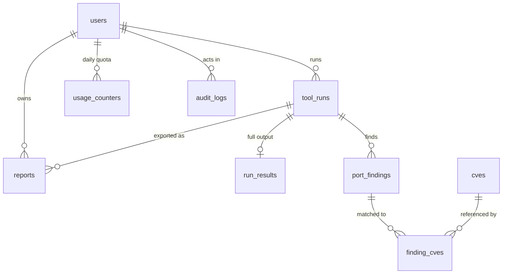

# DATABASE DESIGN — CyberSec Toolkit (PostgreSQL + Prisma)

> **For OpenCode.** This is the single source of truth for the schema. Phase 2 tasks copy from here.
> Do not invent tables or columns that are not in this file. If something seems missing, stop and ask.

---

## 1. Design principles

1. **Access patterns first.** Every index below exists because a named query needs it (section 3). No speculative indexes.
2. **Hot tables stay narrow.** Big JSON blobs live in 1:1 side tables so list queries never drag them through the buffer cache.
3. **Atomic by construction.** Quota enforcement is ONE SQL statement, not read-modify-write (the old Python code had a race here).
4. **Append-heavy tables are cheap to scan and cheap to purge:** bigint identity keys, BRIN on time columns, batched deletes.
5. **Database enforces invariants,** not just the app: CHECK constraints, FKs with explicit `ON DELETE`, NOT NULL by default.
6. **Normalize what you query, keep JSONB for what you only display.** CVE links and port findings are rows; raw NVD payloads are JSONB.
7. **Hot, short-lived caches (WHOIS, GeoIP, DNS) go to Redis in Phase 4/5, not Postgres.** Only durable, expensive-to-recompute data (CVEs) is cached here.
8. **Deny by default.** Row-Level Security is enabled on every table with no policies, so the Supabase public API (anon key) can read nothing. The Node server connects with a privileged role and bypasses RLS.

### Conventions
- Tables `snake_case` plural, columns `snake_case`, mapped with `@map`/`@@map` in Prisma.
- All timestamps `timestamptz` (`@db.Timestamptz(3)`), always UTC.
- Primary keys: **UUIDv7** (`@default(uuid(7))`, time-ordered → good B-tree locality) for entities exposed in URLs; **bigint identity** for internal high-volume child rows.
- Enums are Postgres enums (adding a value later: `ALTER TYPE ... ADD VALUE`).
- Never `prisma db push` outside throwaway local experiments. Production uses `prisma migrate deploy` only.

---

## 2. Entity-relationship overview



Standalone: `service_cve_lookups` (NVD cache), `webhook_events` (idempotency log).

---

## 3. Access patterns → indexes (the contract)

| # | Query | Frequency | Served by |
|---|---|---|---|
| Q1 | Resolve user by Clerk id on every request | every request | `users.clerk_user_id` UNIQUE |
| Q2 | Consume one daily quota unit (atomic) | every tool call | PK `(user_id, tool, usage_date)` |
| Q3 | "My history" newest first, keyset pagination | high | `tool_runs (user_id, created_at DESC, id DESC)` |
| Q4 | "My history" filtered by tool | medium | `tool_runs (user_id, tool, created_at DESC)` |
| Q5 | Dedupe: recent identical run for same target | high | `tool_runs (user_id, tool, target_key, created_at DESC)` |
| Q6 | Worker pulls/reaper finds stale running jobs | background | partial `tool_runs (heartbeat_at) WHERE status='RUNNING'` |
| Q7 | Show queue / active jobs | low | partial `tool_runs (status, queued_at) WHERE status IN ('QUEUED','RUNNING')` |
| Q8 | Load a run's findings, sorted by port | high | UNIQUE `port_findings (run_id, port, protocol)` |
| Q9 | CVEs for a finding / findings for a CVE | medium | PK `finding_cves (finding_id, cve_id)` + index `(cve_id)` |
| Q10 | CVE cache expiry sweep | background | `cves (expires_at)`, `service_cve_lookups (expires_at)` |
| Q11 | My reports, newest first | medium | `reports (user_id, created_at DESC)` |
| Q12 | Webhook replay guard | every webhook | PK `webhook_events (id)` |
| Q13 | Audit trail by actor / time range | rare | `audit_logs (actor_id, created_at DESC)` + BRIN `(created_at)` |

**Keyset pagination (never OFFSET):**
```sql
SELECT id, tool, target, status, created_at
FROM tool_runs
WHERE user_id = $1
  AND (created_at, id) < ($2, $3)     -- cursor from last row of previous page
ORDER BY created_at DESC, id DESC
LIMIT 20;
```

**Atomic quota consumption (Q2) — the core trick:**
```sql
INSERT INTO usage_counters (user_id, tool, usage_date, used)
VALUES ($1, $2::"ToolName", (now() AT TIME ZONE 'UTC')::date, 1)
ON CONFLICT (user_id, tool, usage_date)
DO UPDATE SET used = usage_counters.used + 1, updated_at = now()
WHERE usage_counters.used < $3          -- $3 = daily limit
RETURNING used;
-- 1 row returned  -> allowed (used = new count)
-- 0 rows returned -> limit reached, nothing was changed
```
Concurrency-safe because Postgres row-locks the conflicting row; two racing requests serialize and the second sees the updated `used`. The same rows double as per-day usage history (1 row per user/tool/day instead of 1 per call).

---

## 4. Complete draft `prisma/schema.prisma`

> Prisma 7 note: the datasource URL lives in `prisma.config.ts`, not here, and a driver adapter is required. Prisma 6 needs `url`/`directUrl` in the datasource instead. **Follow the `prisma-database-setup` skill for the exact version in use** and adjust only the `generator`/`datasource` blocks. Do not change models.

```prisma
generator client {
  provider = "prisma-client"
  output   = "../src/generated/prisma"
}

datasource db {
  provider = "postgresql"
}

// ───────────── Enums ─────────────
enum UserTier   { FREE PAID }
enum UserRole   { USER ADMIN }
enum ToolName   { PORT_SCAN WEBAPP_SCAN DNS WHOIS PING TRACEROUTE SSL HTTP_HEADERS SUBDOMAIN GEOIP }
enum RunStatus  { QUEUED RUNNING COMPLETED FAILED CANCELLED TIMED_OUT }
enum Protocol   { TCP UDP }
enum PortState  { OPEN CLOSED FILTERED OPEN_FILTERED }
enum Severity   { INFO LOW MEDIUM HIGH CRITICAL }
enum ReportFormat { JSON CSV PDF }

// ───────────── Identity ─────────────
model User {
  id          String    @id @default(uuid(7)) @db.Uuid
  clerkUserId String    @unique @map("clerk_user_id") @db.VarChar(64)
  email       String?   @unique @db.VarChar(320)      // stored lower-cased; set NULL on account deletion
  tier        UserTier  @default(FREE)
  role        UserRole  @default(USER)
  isActive    Boolean   @default(true) @map("is_active")
  deletedAt   DateTime? @map("deleted_at") @db.Timestamptz(3)
  createdAt   DateTime  @default(now()) @map("created_at") @db.Timestamptz(3)
  updatedAt   DateTime  @updatedAt @map("updated_at") @db.Timestamptz(3)

  toolRuns      ToolRun[]
  usageCounters UsageCounter[]
  reports       Report[]
  auditLogs     AuditLog[]

  @@map("users")
}

// ───────────── Quota (1 row per user/tool/day) ─────────────
model UsageCounter {
  userId    String   @map("user_id") @db.Uuid
  tool      ToolName
  usageDate DateTime @map("usage_date") @db.Date
  used      Int      @default(0)
  updatedAt DateTime @default(now()) @map("updated_at") @db.Timestamptz(3)

  user User @relation(fields: [userId], references: [id], onDelete: Cascade)

  @@id([userId, tool, usageDate])
  @@index([usageDate])                                  // retention sweep
  @@map("usage_counters")
}

// ───────────── Runs (hot, narrow table) ─────────────
model ToolRun {
  id           String    @id @default(uuid(7)) @db.Uuid
  userId       String    @map("user_id") @db.Uuid
  tool         ToolName
  target       String    @db.VarChar(255)               // exactly as submitted
  targetKey    String    @map("target_key") @db.VarChar(255) // normalized: lower-case host / canonical IP
  status       RunStatus @default(QUEUED)
  options      Json?     @db.JsonB                      // validated tool options
  summary      Json?     @db.JsonB                      // tiny (<1 KB): counts, risk score — for list views
  progressPct  Int       @default(0) @map("progress_pct") @db.SmallInt
  attempt      Int       @default(0) @db.SmallInt
  workerId     String?   @map("worker_id") @db.VarChar(100)
  heartbeatAt  DateTime? @map("heartbeat_at") @db.Timestamptz(3)
  errorCode    String?   @map("error_code") @db.VarChar(60)
  errorMessage String?   @map("error_message") @db.VarChar(1000)
  queuedAt     DateTime  @default(now()) @map("queued_at") @db.Timestamptz(3)
  startedAt    DateTime? @map("started_at") @db.Timestamptz(3)
  finishedAt   DateTime? @map("finished_at") @db.Timestamptz(3)
  createdAt    DateTime  @default(now()) @map("created_at") @db.Timestamptz(3)

  user     User          @relation(fields: [userId], references: [id], onDelete: Cascade)
  result   RunResult?
  findings PortFinding[]
  reports  Report[]

  @@index([userId, createdAt(sort: Desc), id(sort: Desc)])          // Q3
  @@index([userId, tool, createdAt(sort: Desc)])                    // Q4
  @@index([userId, tool, targetKey, createdAt(sort: Desc)])         // Q5
  @@map("tool_runs")
  // Partial indexes for Q6/Q7 are added in the raw-SQL migration (Prisma cannot express WHERE).
}

// Full output, 1:1, TOASTed JSONB. Never joined in list queries.
model RunResult {
  runId     String   @id @map("run_id") @db.Uuid
  data      Json     @db.JsonB
  createdAt DateTime @default(now()) @map("created_at") @db.Timestamptz(3)

  run ToolRun @relation(fields: [runId], references: [id], onDelete: Cascade)

  @@map("run_results")
}

// ───────────── Port-scan findings (high row count → bigint identity) ─────────────
model PortFinding {
  id        BigInt    @id @default(autoincrement())
  runId     String    @map("run_id") @db.Uuid
  port      Int
  protocol  Protocol  @default(TCP)
  state     PortState
  service   String?   @db.VarChar(100)
  version   String?   @db.VarChar(255)
  banner    String?   @db.VarChar(2000)
  risk      Severity?

  run  ToolRun       @relation(fields: [runId], references: [id], onDelete: Cascade)
  cves FindingCve[]

  @@unique([runId, port, protocol])                                  // Q8
  @@map("port_findings")
}

// ───────────── CVE knowledge (durable cache of NVD) ─────────────
model Cve {
  id          String    @id @db.VarChar(20)               // "CVE-2024-12345"
  cvssScore   Decimal?  @map("cvss_score") @db.Decimal(3, 1)
  severity    Severity?
  summary     String?   @db.Text
  data        Json      @db.JsonB                         // raw NVD record
  publishedAt DateTime? @map("published_at") @db.Timestamptz(3)
  fetchedAt   DateTime  @default(now()) @map("fetched_at") @db.Timestamptz(3)
  expiresAt   DateTime  @map("expires_at") @db.Timestamptz(3)

  findings FindingCve[]

  @@index([expiresAt])
  @@map("cves")
}

model FindingCve {
  findingId BigInt @map("finding_id")
  cveId     String @map("cve_id") @db.VarChar(20)

  finding PortFinding @relation(fields: [findingId], references: [id], onDelete: Cascade)
  cve     Cve         @relation(fields: [cveId], references: [id], onDelete: Restrict)

  @@id([findingId, cveId])
  @@index([cveId])                                                   // Q9 reverse lookup
  @@map("finding_cves")
}

// "nginx 1.18.0" -> [CVE ids]; avoids re-calling NVD (rate limited) for every scan.
model ServiceCveLookup {
  cacheKey  String   @id @map("cache_key") @db.Char(64)  // sha256(lower(service)|version)
  service   String   @db.VarChar(100)
  version   String   @db.VarChar(100)
  cveIds    String[] @map("cve_ids")
  fetchedAt DateTime @default(now()) @map("fetched_at") @db.Timestamptz(3)
  expiresAt DateTime @map("expires_at") @db.Timestamptz(3)

  @@index([expiresAt])
  @@map("service_cve_lookups")
}

// ───────────── Reports (metadata only; files live in object storage) ─────────────
model Report {
  id         String       @id @default(uuid(7)) @db.Uuid
  userId     String       @map("user_id") @db.Uuid
  runId      String       @map("run_id") @db.Uuid
  format     ReportFormat
  storageKey String       @map("storage_key") @db.VarChar(500)
  sizeBytes  Int          @map("size_bytes")
  sha256     String       @db.Char(64)
  createdAt  DateTime     @default(now()) @map("created_at") @db.Timestamptz(3)
  expiresAt  DateTime?    @map("expires_at") @db.Timestamptz(3)

  user User    @relation(fields: [userId], references: [id], onDelete: Cascade)
  run  ToolRun @relation(fields: [runId], references: [id], onDelete: Cascade)

  @@index([userId, createdAt(sort: Desc)])                           // Q11
  @@index([runId])
  @@map("reports")
}

// ───────────── Webhook idempotency ─────────────
model WebhookEvent {
  id          String    @id @db.VarChar(100)              // svix-id header
  source      String    @db.VarChar(30)                   // "clerk"
  eventType   String    @map("event_type") @db.VarChar(100)
  receivedAt  DateTime  @default(now()) @map("received_at") @db.Timestamptz(3)
  processedAt DateTime? @map("processed_at") @db.Timestamptz(3)
  error       String?   @db.VarChar(1000)

  @@index([receivedAt])
  @@map("webhook_events")
}

// ───────────── Audit trail (append-only) ─────────────
model AuditLog {
  id         BigInt   @id @default(autoincrement())
  actorId    String?  @map("actor_id") @db.Uuid
  action     String   @db.VarChar(60)                     // "user.deleted", "tier.changed", "scan.blocked_target"
  entityType String?  @map("entity_type") @db.VarChar(40)
  entityId   String?  @map("entity_id") @db.VarChar(64)
  ip         String?  @db.Inet
  userAgent  String?  @map("user_agent") @db.VarChar(300)
  metadata   Json?    @db.JsonB
  createdAt  DateTime @default(now()) @map("created_at") @db.Timestamptz(3)

  actor User? @relation(fields: [actorId], references: [id], onDelete: SetNull)

  @@index([actorId, createdAt(sort: Desc)])                          // Q13
  @@index([createdAt], type: Brin)                                   // range scans, ~1000x smaller than B-tree
  @@map("audit_logs")
}
```

---

## 5. Raw-SQL migration (create with `prisma migrate dev --create-only --name db_invariants`, then paste)

```sql
-- ── CHECK constraints: the DB refuses nonsense even if app code is buggy ──
ALTER TABLE usage_counters ADD CONSTRAINT usage_counters_used_nonneg  CHECK (used >= 0);
ALTER TABLE tool_runs      ADD CONSTRAINT tool_runs_progress_range     CHECK (progress_pct BETWEEN 0 AND 100);
ALTER TABLE tool_runs      ADD CONSTRAINT tool_runs_attempt_nonneg     CHECK (attempt >= 0);
ALTER TABLE tool_runs      ADD CONSTRAINT tool_runs_time_order         CHECK (finished_at IS NULL OR started_at IS NULL OR finished_at >= started_at);
ALTER TABLE tool_runs      ADD CONSTRAINT tool_runs_finished_has_time  CHECK (status NOT IN ('COMPLETED','FAILED','CANCELLED','TIMED_OUT') OR finished_at IS NOT NULL);
ALTER TABLE port_findings  ADD CONSTRAINT port_findings_port_range     CHECK (port BETWEEN 1 AND 65535);
ALTER TABLE reports        ADD CONSTRAINT reports_size_nonneg          CHECK (size_bytes >= 0);
ALTER TABLE users          ADD CONSTRAINT users_email_lowercase        CHECK (email IS NULL OR email = lower(email));
ALTER TABLE cves           ADD CONSTRAINT cves_id_format               CHECK (id ~ '^CVE-[0-9]{4}-[0-9]{4,}$');

-- ── Partial indexes (tiny, because they only cover live jobs) ──
CREATE INDEX ix_tool_runs_running_heartbeat ON tool_runs (heartbeat_at) WHERE status = 'RUNNING';        -- Q6 reaper
CREATE INDEX ix_tool_runs_active            ON tool_runs (status, queued_at) WHERE status IN ('QUEUED','RUNNING'); -- Q7

-- ── Row-Level Security: deny-by-default for Supabase's public API ──
ALTER TABLE users              ENABLE ROW LEVEL SECURITY;
ALTER TABLE usage_counters     ENABLE ROW LEVEL SECURITY;
ALTER TABLE tool_runs          ENABLE ROW LEVEL SECURITY;
ALTER TABLE run_results        ENABLE ROW LEVEL SECURITY;
ALTER TABLE port_findings      ENABLE ROW LEVEL SECURITY;
ALTER TABLE cves               ENABLE ROW LEVEL SECURITY;
ALTER TABLE finding_cves       ENABLE ROW LEVEL SECURITY;
ALTER TABLE service_cve_lookups ENABLE ROW LEVEL SECURITY;
ALTER TABLE reports            ENABLE ROW LEVEL SECURITY;
ALTER TABLE webhook_events     ENABLE ROW LEVEL SECURITY;
ALTER TABLE audit_logs         ENABLE ROW LEVEL SECURITY;
-- No policies on purpose. The server connects as the owner role (bypasses RLS).
-- Plain local Postgres (non-Supabase) also accepts this; harmless there.

-- ── Autovacuum tuning for the churn-heavy table (status updates create dead tuples) ──
ALTER TABLE tool_runs SET (autovacuum_vacuum_scale_factor = 0.05, autovacuum_analyze_scale_factor = 0.02);
ALTER TABLE usage_counters SET (autovacuum_vacuum_scale_factor = 0.05, fillfactor = 85);  -- HOT updates
```

---

## 6. Performance budget (verified in Phase 2 task T2.20)

Seed **1,000,000 `tool_runs`** across 1,000 users + 3,000,000 `port_findings`, then `EXPLAIN (ANALYZE, BUFFERS)`:

| Query | Required plan | Budget |
|---|---|---|
| Q1 user by clerk id | Index Scan on `users_clerk_user_id_key` | < 1 ms |
| Q2 quota consume | Index Scan / ON CONFLICT on PK | < 2 ms |
| Q3 history page (keyset) | Index Scan on `(user_id, created_at, id)`, **no Sort node** | < 3 ms |
| Q5 dedupe lookup | Index Scan, `LIMIT 1` | < 2 ms |
| Q6 stale running jobs | Index Scan on partial index | < 2 ms |
| Q8 findings of a run | Index Scan on `(run_id, port, protocol)`, no Sort | < 3 ms |

Any `Seq Scan` on `tool_runs` / `port_findings` / `usage_counters` in these queries = **fail**, fix the index before continuing.

---

## 7. Connections

- App runtime → **pooled** connection string (Supabase pooler, transaction mode) → `DATABASE_URL`.
- Migrations → **direct** connection (not pooled; DDL and advisory locks break under transaction pooling) → `DIRECT_URL`.
- Prisma pool per Node process: start at `max: 10`; total across processes must stay below the DB's connection limit.
- Set `statement_timeout` (e.g. 10 s) and `idle_in_transaction_session_timeout` (e.g. 15 s) on the application role.

---

## 8. Retention & scale path (documented now, implemented later)

| Data | Policy | Where |
|---|---|---|
| `tool_runs` + children | Free tier: 90 days; deleted in batches of 5,000 with `DELETE ... WHERE id IN (SELECT id ... LIMIT 5000)` | Phase 6 scheduled job |
| `usage_counters` | keep 400 days | Phase 6 |
| `webhook_events` | 30 days | Phase 6 |
| `cves`, `service_cve_lookups` | rows past `expires_at` | Phase 7 |
| `audit_logs` | keep; BRIN makes range scans cheap | — |

**Upgrade path if `tool_runs` passes ~100M rows:** convert to monthly range partitions on `created_at` (PK becomes `(id, created_at)`, child FKs carry `created_at`), then retention becomes `DROP PARTITION` (instant). Do NOT do this now: Prisma has no native partition support and it costs complexity you do not need at this scale.

**Deliberately not in Postgres:** job queue (BullMQ/Redis), worker heartbeats (Redis TTL keys), session revocation (Redis), WHOIS/GeoIP/DNS caches (Redis).
