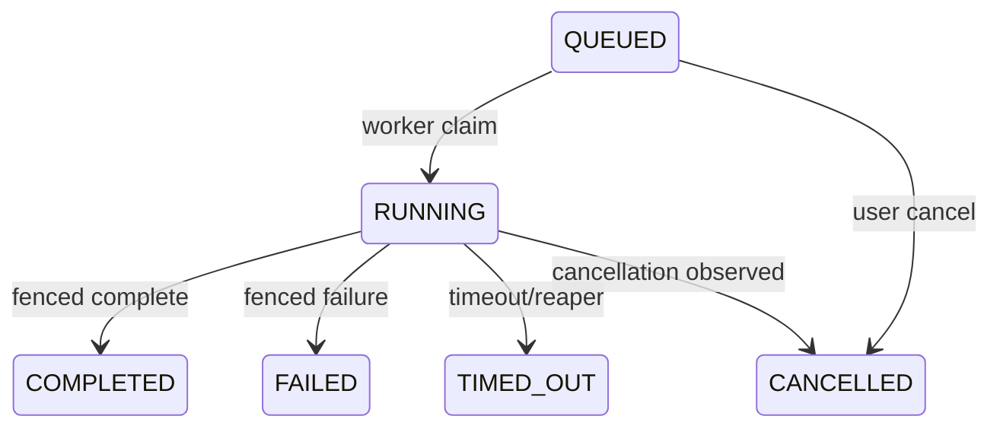

# Queue architecture

Postgres is authoritative for every transition. Redis carries queue entries
and notifications; a queue loss is repaired by the reaper from `tool_runs`.
Workers claim with a guarded update and fence all later writes by worker id and
attempt. Refunds are guarded by `quota_refunded` and are therefore once-only.

Admission order is submit limiters, validation, target protection, queue depth,
quota, active-run cap, then enqueue. Workers revalidate target policy before
connecting. Terminal runs are retained by user tier; active runs are never
deleted by retention.
